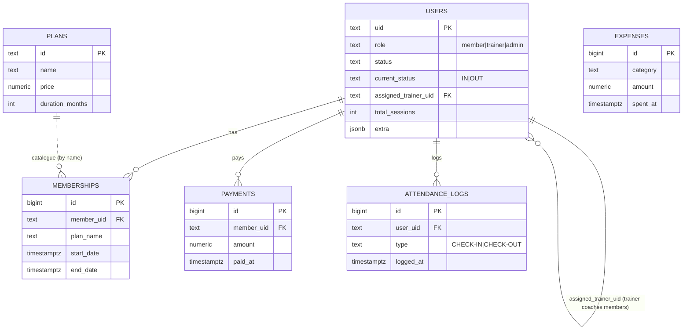

# AURA Athletic Club - DBMS viva notes (PostgreSQL on Supabase)

## Why PostgreSQL
Relational model with keys, constraints, transactions and SQL; the app's data (members, trainers, plans, payments, attendance) is naturally relational. Hosted on Supabase (managed Postgres). Firebase Auth is kept only for Google login.

## ER diagram (Mermaid: paste into mermaid.live)

## Normalisation
- **UNF:** Firestore `users` document nested plan, trainer details and attendance inside the user; attendance was stored in 3 places.
- **1NF:** every column atomic; no maps/arrays; one attendance table.
- **2NF:** plan details depend on the membership, not the user -> moved to `memberships` (one row per subscription period, giving renewal history).
- **3NF:** trainer name/phone/email were copied into each member -> now only `assigned_trainer_uid` (FK), details come from a join. `membership_status` is a view, not stored data.
- Leftover denormalisation (say it honestly): `memberships.plan_name/price` are copied from the plan at purchase time so old prices stay correct; `users.extra` JSONB holds unknown legacy fields.

## Constraints and features to demo
- PK/FK with `ON DELETE`, `CHECK` (role, type, amount >= 0, end_date >= start_date), `NOT NULL`, `DEFAULT`.
- Indexes: `idx_att_user_time`, `idx_users_phone`, `idx_users_role_status` (show `EXPLAIN ANALYZE` in `db/queries.sql`).
- View: `membership_status` (ACTIVE / EXPIRING / EXPIRED).
- Transaction + row lock: check-in/out runs `BEGIN; SELECT ... FOR UPDATE; UPDATE; INSERT log; COMMIT;` so two simultaneous scans cannot both succeed (isolation / atomicity). Renewal inserts membership + payment in one transaction.
- Aggregates / window functions: see `db/queries.sql` (KPIs, GROUP BY, streak with ROW_NUMBER()).

## Likely questions
- *Why not NoSQL?* Fixed structure, relations between entities, need for joins, constraints and transactions.
- *ACID example?* Renewal: payment and membership are both saved or neither.
- *Why polling?* The browser logs in with Firebase, not Supabase, so it can't query tables directly; the page re-reads `/api/me` every 3 s.
